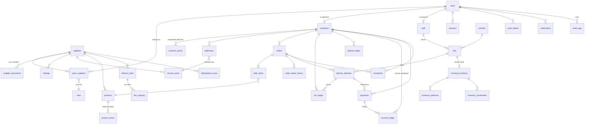

# WtrDrop: Phase 0 Analysis

**Status:** Draft for review. No code has been written.
**Date:** 19 November 2026
**Prepared for:** Sreelakshmi (product owner)

---

## How to read this document

**Source of requirements.** You confirmed there is no separate requirements document, so your master prompt ("WtrDrop – Master Product Development & Implementation Prompt", 19 Nov 2026) is the full original requirement set. Everything labelled [ORIG] comes from it. The `waterdrop-platform` repository is empty, with no commits (Appendix A).

Where your prompt does not say something and I needed a business fact (prices, volumes, current process), I have **not assumed it**. The item is listed as a question in §17.

Labels used throughout:

| Label | Meaning |
|---|---|
| **[ORIG]** | Requirement taken from your master prompt |
| **[PROP]** | My proposed improvement or change. Nothing is approved yet. |
| **[APPROVED]** | Decision you have approved. There are none yet. |
| **[PENDING]** | Decision still open. See §17 and the decision register in `REQUIREMENTS-CHANGELOG.md` |
| **Must Have / Recommended / Optional / Not Recommended** | Priority categories from your §15 |

Companion files in this folder:

- `REQUIREMENTS-CHANGELOG.md`: every original requirement I recommend changing, with its status.
- `PROGRESS.md`: development progress log, for continuity across Claude Code sessions.

---

## Contents

1. Understanding of the business
2. Module and feature analysis
3. User journeys
4. Real-world feasibility assessment
5. Missing requirements and operational scenarios
6. Conflicting or unclear business rules
7. UX improvements for minimum clicks
8. Technical architecture recommendations
9. Proposed database ERD
10. Proposed folder structure
11. API design overview
12. Security and QA strategy
13. MVP scope and implementation priorities
14. Original requirements I recommend changing
15. Additional features I recommend
16. Features to postpone or remove
17. Questions for the business owner

Appendix A covers the repository inspection (Phase 0 steps 1 to 4).

---

## 1. Understanding of the business

**What the business is.** It is an existing drinking-water supplier in Kerala that delivers **20-litre reusable cans** to households, offices, shops, clinics, hostels and small eateries. The cans are company-owned, usually polycarbonate or PET, and returnable. Each delivery is normally a **swap**: a full can goes in and an empty can comes out. Today the business most likely runs on phone calls, WhatsApp messages, a notebook or register, and the owner's memory (to confirm, §17 Q8).

**How it makes money.** It charges a per-can price, plus a delivery charge in some cases, and a refundable deposit when a customer first takes cans. Margins are thin, so the costs that matter are:

- **Lost cans.** A 20L can costs several hundred rupees. A business with 1,000 cans in circulation can lose a great deal through slow leakage to customers who never return them.
- **Uncollected money.** Regular customers and offices often pay later, by the week or month. Small dues add up.
- **Wasted trips.** A trip is wasted when the customer is not home, the address is wrong, or the vehicle was loaded with the wrong number of cans.
- **Staff cash handling.** Staff collect cash on the route, and it has to be reconciled every evening.

**What WtrDrop actually needs to fix, in order of business value:**

1. **Know who holds how many of our cans** (the can ledger) and stop the leakage.
2. **Know who owes how much money** (customer dues) and collect it.
3. **Capture orders without phone tag**: let customers reorder in seconds, and let the owner see every order in one place, including the ones that still come in by phone.
4. **Run the day's deliveries smoothly**: staff know what is next, record what happened in a few taps, and the owner sees it live.
5. **Reconcile at day end**: cans and cash the vehicle left with, compared with cans and cash it came back with.

Online ordering is only part of this. **The ledger, the dues and the day-end reconciliation are what make the business more profitable.** The design below puts those at the centre.

**Kerala-specific context that shapes the design:**

- Addresses are landmark-based ("near St. Mary's church, 2nd lane, blue gate"). A map pin and a landmark field matter more than formal address lines.
- Pincodes in Kerala cover large, mixed areas. Pincode alone is a weak service-area check.
- Mobile data is patchy in some places, especially hilly or rural pockets, inside apartment basements, and during monsoon. The staff app must tolerate this.
- UPI is near-universal: customers pay by scanning the business QR code. Cash is still common with older customers.
- Malayalam matters for older customers and for staff. Staff may prefer Malayalam with large icons.
- Demand peaks in summer (March to May) and during water-supply disruptions, so stock and capacity limits matter more then.
- A large share of customers are repeat customers on a predictable cycle. One or two cans every few days is typical.

---

## 2. Module and feature analysis

For each module: what it is for, how it depends on other modules, my assessment, and its category. "Category" means the category for the **first release (MVP)**.

### 2A. Customer mobile app [ORIG]

| # | Feature | Assessment | Category |
|---|---|---|---|
| 1 | Registration and authentication | Phone number + OTP is the natural choice in India. There are no passwords to forget. See D-01. | Must Have |
| 2 | Customer profile | Keep it minimal: name, phone, preferred language. Email optional. | Must Have |
| 3 | Address management | A map pin and a landmark are essential. Most customers have one address, so offices with several addresses are the edge case. | Must Have |
| 4 | Service-area validation | Must Have, but the method matters. See §6 and D-06. | Must Have |
| 5 | Product catalogue | The business probably sells one to three products (20L can, maybe a dispenser or pump; to confirm, §17 Q5). A catalogue *screen* is unnecessary if there is one product. The order screen should open directly on the can. | Must Have (data), screen simplified |
| 6 | 20L can ordering | This is the core action and must be the home-screen hero. | Must Have |
| 7 | Cart and checkout | A multi-item cart is overkill for one product. Use a **single-screen order** (quantity stepper → summary → place). A cart appears only if there are several products. | Must Have (simplified) |
| 8 | Delivery date and slot | Useful, but strict slots are hard to honour for a route-based business. See D-07. | Must Have (simplified) |
| 9 | Order confirmation | One success screen showing the expected delivery window and the amount due. No extra confirm dialog. | Must Have |
| 10 | Order history | Simple list. Also the place to "reorder" and "report a problem". | Must Have |
| 11 | Delivery tracking | Status-based tracking (Placed → Out for delivery → Delivered) is enough. Live GPS map tracking is **Not Recommended** for MVP. See §16. | Must Have (status-based) |
| 12 | Reorder | It is the most-used action and must be one tap from home. | Must Have |
| 13 | Payment history | Show it together with **amount due** (dues are missing from the original). | Must Have |
| 14 | Full-can / empty-can balance | Show "You have **3** of our cans" on home. This number reduces disputes. | Must Have |
| 15 | Complaints and support | Keep it simple: pick an order, pick a reason, add an optional note or photo. Add a "Call us" and a "WhatsApp us" button. | Must Have (simple) |
| 16 | Notifications | Push via FCM for status changes. See §15 for WhatsApp. | Must Have (push) |
| 17 | Malayalam and English | Must Have. Needs a native-speaker review of all strings. | Must Have |

### 2B. Delivery staff app [ORIG]

| # | Feature | Assessment | Category |
|---|---|---|---|
| 1 | Secure staff login | Phone + OTP on first login, then a 4-digit PIN or biometric on that device. Staff should not receive an OTP every morning. See D-02. | Must Have |
| 2 | Assigned deliveries | It is the home screen: "Today's route", in sequence, with the **next stop at the top**. | Must Have |
| 3 | Delivery schedule | Merge into #2. A separate schedule screen duplicates the route list. Upcoming days can be a tab. | Merge into #2 |
| 4 | Customer information | Show name, phone (tap to call), cans held, amount due and delivery notes. Show only what the staff member needs at the door. | Must Have |
| 5 | Address and navigation | Hand off to the Google Maps app with a deep link. Do not build in-app navigation. | Must Have |
| 6 | Status updates | Keep these to two big actions per stop: **Delivered** and **Couldn't deliver**. "Out for delivery" should be set for the whole route at once ("Start route"), not stop by stop. | Must Have |
| 7 | Full cans delivered | Part of the single "Delivered" screen, prefilled with the ordered quantity. | Must Have |
| 8 | Empty cans collected | Same screen, same flow. See D-09 for the default value. | Must Have |
| 9 | Cash / UPI recording | Same screen. Prefilled with the amount due today. Options: Cash / UPI / Pay later (if allowed for this customer). | Must Have |
| 10 | Failed delivery reasons | Pick one of 5 or 6 preset reasons. Notes optional. | Must Have |
| 11 | Delivery confirmation | Covered by the "Delivered" screen. **No separate confirmation step.** | Merge into #7–9 |
| 12 | Delivery history | Today's completed stops plus a short history. | Must Have (simple) |
| + | Route sequencing | Manual ordering is enough: the admin arranges, or staff drag to reorder. Automatic optimisation is not needed. | Recommended (manual) |
| + | Offline capture | Recommended, to the extent of queuing actions while offline. Patchy data on routes is normal in Kerala. | **Must Have** (queued actions) |
| + | Proof of delivery | A GPS location and timestamp captured automatically on "Delivered" costs nothing. A photo is optional. A customer OTP or signature adds friction. | GPS stamp Recommended, photo Optional, OTP/signature Not Recommended |
| + | Vehicle load and day-end reconciliation | **Missing from the original.** See §5. | **Must Have** |
| + | Walk-in / unplanned sale | A neighbour who asks for a can on the spot. **Missing from the original.** | Recommended |

### 2C. Admin web portal [ORIG]

| # | Feature | Assessment | Category |
|---|---|---|---|
| 1 | Dashboard | Make it an **action inbox**, not a wall of charts. See §7. | Must Have |
| 2 | Customer management | It must allow the admin to **create a customer and place orders for them** (phone and WhatsApp orders will continue). | Must Have |
| 3 | Product and pricing | Prices are effective-dated, so history is preserved. Customer-specific prices are likely needed for offices (D-11). | Must Have |
| 4 | Order management | List with filters by today, status and area. Bulk accept and bulk assign. | Must Have |
| 5 | Delivery assignment | Assign by area or route. Bulk assignment is essential: assigning one order at a time does not scale. | Must Have |
| 6 | Staff management | Add or disable staff, reset their PIN, see today's progress. | Must Have |
| 7 | Inventory management | Full and empty stock at the depot, plus stock on each vehicle. | Must Have |
| 8 | Full/empty can tracking | Same module as #7. These are two views of one can pool. See §9. | Must Have (merged with #7) |
| 9 | Customer can balances | List of customers with outstanding cans, sortable, with ageing. Ledger corrections with a reason. | Must Have |
| 10 | Payment management | Dues, collections, staff cash handover, UPI reconciliation. | Must Have |
| 11 | Service areas | List of localities or wards, optional map radius. | Must Have |
| 12 | Delivery slots | Simple configuration of windows and capacity. | Must Have (simple) |
| 13 | Complaints | List, status, link to order. | Must Have (simple) |
| 14 | Reports and analytics | Five or six focused reports, not a BI tool. See §13. | Must Have (focused) |
| 15 | Audit logs | Must Have (recorded from day one). A rich viewer UI can be simple. | Must Have |
| 16 | Business settings | Delivery charge, deposit amount, credit rules, cut-off times, contact numbers. | Must Have |

### Module dependencies

The order in which modules can be built is driven by these dependencies:

```
Suppliers / Settings ─┐
Auth & Users/Roles ───┼─► Customers & Addresses ─► Service Areas
                      │                             │
Products & Prices ────┴──────────────► Orders ◄─────┘
                                         │  ▲
                         Inventory ◄─────┤  │ Delivery Slots
                     (reserve/release)   ▼
                                     Deliveries / Trips ─► Can Ledger
                                         │                 Payments / Dues
                                         ▼                 Inventory (actuals)
                                   Notifications, Complaints, Audit, Reports
```

The key point is that **delivery confirmation writes to four places in one transaction**: order status, can ledger, payments and inventory. The ledger, payments and inventory therefore cannot be built after the delivery workflow, as the current phase plan suggests (Phase 5 before Phase 6). See C-14 in §14.

---

## 3. User journeys

These are the target journeys after my proposed UX improvements. Each step names the screen and the taps involved.

### 3.1 Customer: first-time order

1. Installs the app and picks a language (English / മലയാളം). This happens once.
2. Enters phone number → OTP auto-read on Android → verified. (*2 taps*)
3. Enters name. Taps "Set delivery location": the map opens on the current GPS position, the customer drags the pin and adds a landmark or house name. The app checks the service area **immediately**. If the address is outside it, the app says so clearly and offers "Call us" instead of letting the customer continue.
4. Sees the order screen with the 20L can, price, quantity stepper (default 2 **[PENDING D-10]**), the one-time deposit for new cans shown transparently, the delivery charge if any, and the total.
5. Delivery time defaults to the **earliest available window** (for example "Today, evening"). One tap changes it.
6. Payment defaults to "Pay on delivery (Cash/UPI)". (Online payment is postponed. See §16.)
7. Taps **Place order** → success screen: "Arriving today between 4 and 7 pm. Pay ₹X on delivery."

Total: roughly **6 to 8 taps** after sign-up, with no address re-entry ever again.

### 3.2 Customer: regular reorder (the 90% case)

1. Opens the app. The home screen shows: "You have **2** of our cans · ₹0 due" and a big button **"Order 2 cans again · ₹X · Today evening"**.
2. Taps it → one summary sheet → **Place order**.

Total: **2 taps.** (Optional standing orders, §15, would bring it to zero.)

### 3.3 Customer: something goes wrong

- **Not home:** gets a push saying "We couldn't deliver: no one was home. Tap to choose a new time." One tap reschedules it.
- **Wrong count recorded:** opens the order → "Report a problem" → picks "Can count is wrong" → the admin sees it in their inbox.
- **Wants to cancel:** possible in one tap until the order is out for delivery. After that, the app shows "Call us".

### 3.4 Delivery staff: a working day

1. **Morning.** Opens the app → PIN. Sees "Today: 24 stops · Load 52 full cans". The admin has already assigned and sequenced the route. Staff confirm the vehicle load: the expected count is prefilled, and staff adjust it if needed. (*1 to 2 taps*)
2. Taps **Start route** → all assigned orders become OUT_FOR_DELIVERY and customers get a push. (*1 tap*)
3. **At each stop**, the card shows: name, landmark, cans to deliver, cans the customer holds, amount due, notes ("dog at gate", "call before coming").
   - Buttons: **Call** · **Navigate** · **Delivered** · **Couldn't deliver**.
4. **Delivered** opens one screen:
   - Full cans delivered: [ 2 ] (prefilled with the order, +/− steppers)
   - Empty cans collected: [ 2 ] (see D-09)
   - "Customer will now have **2** of our cans" (live result, so mistakes are visible)
   - Payment: **₹X** · [Cash] [UPI] [Later]
   - **Confirm** → next stop slides up automatically. (*typically 2 taps*)
5. **Couldn't deliver** → pick a reason (Not home / Locked / Refused / Wrong address / Out of stock on vehicle / Other) → done. The order goes back to the admin to reschedule. (*2 taps*)
6. **Offline at any point:** actions queue with a visible "3 updates waiting to sync" badge and send automatically when the signal returns.
7. **Evening.** Taps **End day**. The app shows what the vehicle should be carrying back (full cans left, empty cans collected, cash collected) and staff confirm or enter actual counts. Differences are flagged to the admin.

### 3.5 Business owner: a working day

1. Opens the portal and sees a **"Needs attention"** inbox at the top:
   - 8 new orders to accept (or 0 if auto-accept is on)
   - 5 accepted orders not yet assigned
   - 2 failed deliveries to reschedule
   - 1 complaint
   - Ravi's day-end cash is ₹300 short
   - Full-can stock low for tomorrow
2. Below that are today's numbers: orders, delivered, collected (cash/UPI), dues outstanding, cans with customers.
3. **Morning routine:** select today's orders → bulk-assign by area → drag to adjust the sequence → done.
4. **Phone order:** search the customer by phone → "New order" (prefilled with their usual quantity and address) → place.
5. **Correction:** a customer says only 1 empty was taken, not 2 → open the customer → can ledger → "Correct entry" → enter the right count and a reason → a reversing entry is posted and audited. The old entry is never edited.
6. **Weekly:** dues report → call or WhatsApp customers with dues. Can-holding report → chase customers holding too many cans.

---

## 4. Real-world feasibility assessment

| Area | Feasible as written? | Notes |
|---|---|---|
| Customer app ordering | **Yes** | Must be simpler than calling or messaging on WhatsApp, or customers will keep calling. That is why admin-side order entry is Must Have. |
| Adoption by existing customers | **Partly** | Older customers and offices will keep calling. Plan for **mixed channels**: the app is one channel, and the admin enters the rest. Success is measured as "all orders in the system", not "all orders through the app". |
| Delivery staff app | **Yes, if simplified** | Staff with limited tech skills will reject an app that needs more than 2 or 3 taps per stop or fails without signal. Malayalam, big buttons, icons and offline queuing are required. |
| Strict delivery slots | **Doubtful** | A single vehicle running a route cannot promise one-hour slots. Wide windows (morning/afternoon/evening) are realistic. |
| Stock reservation / no overselling | **Partly** | A water plant can fill more cans in the day, so stock is capacity-driven, not a fixed warehouse count. A hard stock block may refuse orders the business could have served. See D-08. |
| Can ledger | **Yes** | It is the most valuable module. It must be append-only with reasoned corrections. |
| Online payments (Razorpay) | **Feasible, low value for MVP** | Most customers pay on delivery by cash or UPI QR. A gateway adds fees (around 2% per transaction), KYC, webhooks and refunds. Recommend postponing. |
| OTP authentication | **Yes** | SMS OTP costs around ₹0.15 to ₹0.30 per message through Indian providers. DLT registration is required in India for SMS. Allow 2 to 4 weeks for it. |
| Live GPS tracking | **Not worth it for MVP** | It drains battery, costs Maps API money, raises staff privacy concerns, and adds little over "You're stop 3 of 10". |
| Multi-supplier future | **Yes** | A `supplier_id` on every tenant table and tenant scoping in the data-access layer from day one. Low cost now, and it avoids a rewrite later. Do not build supplier onboarding yet. |
| Malayalam | **Yes** | Needs translation and review by a native speaker, plus a Malayalam-capable font (Noto Sans Malayalam). Strings must never be hardcoded. |
| Testing toolset | **Mostly** | Appium with Expo is heavy and brittle. Maestro is a better fit. See C-12. JMeter is fine, and k6 is an option. |
| Data protection | **Must plan** | India's DPDP Act 2023 applies: consent at sign-up, a privacy notice, purpose limitation, deletion on request. Hosting in an Indian region is recommended. |

---

## 5. Missing requirements and operational scenarios

These are scenarios from your list plus others I identified, with the behaviour I recommend. **[PROP]** unless noted.

### 5.1 Scenarios from your list

| Scenario | Recommended behaviour |
|---|---|
| Customer orders multiple cans | Quantity stepper with a configurable max per order (for example 10). Larger quantities are flagged for admin review. |
| Returns fewer empties than full cans delivered | Allowed. The ledger records it and the balance goes up. If the balance exceeds the customer's **deposit cover** (cans paid for by deposit), the staff app shows a warning and the admin chooses the policy (D-04): charge deposit, allow on credit, or block. |
| Outstanding empty-can balance | Shown to the customer on home, to staff at the door, and to the admin with ageing ("3 cans held for 45+ days"). |
| Regular orders | One-tap reorder (MVP). Standing orders are Recommended (§15). |
| Multiple deliveries per route | The trip/route entity groups the day's stops in sequence, with load-out and day-end reconciliation. |
| Customer unavailable | "Couldn't deliver → Not home" → FAILED_DELIVERY on this attempt → the customer is notified and can reschedule. The admin sees it in the inbox. Stock goes back to the vehicle and then the depot. |
| Partial delivery | Staff deliver fewer cans than ordered, for example because the vehicle ran short. Record the actual quantity. The order closes as delivered-short and the shortfall is either cancelled or turned into a follow-up order (D-05). |
| Failed delivery and rescheduling | A delivery **attempt** fails. The **order** is not closed: it returns to "to be rescheduled" and can be reassigned. Attempts are kept as history. |
| Cash and UPI | Both recorded by staff. UPI goes to the business QR, and staff record it with an optional last-4/UTR. The admin reconciles against the bank statement. |
| Customer pays later | Needs a **customer money ledger** (dues). This is missing from the original: payments alone do not show what is owed. A credit limit is set per customer (D-03). |
| Incorrect delivery or empty-can entries | Staff can **undo within 10 minutes** of confirming. After that, only the admin can correct, through reversing ledger entries with a reason. |
| Staff with limited technical knowledge | Malayalam UI, icons with words, 2 taps per stop, no free typing needed, big targets (≥ 48dp), forgiving undo. |
| Owner correcting mistakes | Corrections everywhere are additive, never destructive: reversals, adjustments, status overrides with a reason. All are audited. |
| Stock shortages at peak | Daily or slot capacity limits stop customers from booking more than can be delivered. The admin sees "tomorrow: 180 ordered / 200 capacity". |
| Customer changes address | The order keeps a **snapshot** of the address used. Changing the address before dispatch updates the order and re-checks the service area. Changing it after dispatch means calling the business. |
| Order cancelled after assignment | Allowed by the customer until OUT_FOR_DELIVERY, and by the admin anytime before DELIVERED. The reservation is released. If the cans are already on the vehicle, they come back in day-end reconciliation. |
| Internet problems during delivery | The day's route is cached on the phone. Actions are queued with idempotency keys and synced in order. The server rejects duplicates safely. |

### 5.2 Additional scenarios and requirements missing from the original

| # | Missing item | Why it matters | Category |
|---|---|---|---|
| M-01 | **Admin creates orders for customers** (phone/WhatsApp orders) | Many customers will not use the app. If those orders are not in the system, the ledger and dues are wrong. | Must Have |
| M-02 | **Customer dues / money ledger** (amount owed, credit) | "Pay later" needs a balance. Payment history alone is not enough. | Must Have |
| M-03 | **Vehicle load-out and day-end reconciliation** (cans and cash) | This is where most real-world leakage happens: cans and cash that do not come back. | Must Have |
| M-04 | **Opening balances on go-live** | Existing customers already hold cans and some owe money. These must be imported as audited opening entries, or every balance starts wrong. | Must Have |
| M-05 | **Deposit handling**: charge on first cans, track deposit cover, refund when an account closes and cans come back | You listed deposits as separate from outstanding cans, which is correct, but the rules for charging, refunding and topping up deposits are not defined. | Must Have |
| M-06 | **Damaged, leaking, lost or foreign cans** | Customers return cracked cans, a competitor's can, or claim a can was stolen. Inventory must record damaged and written-off cans, and the ledger needs a "returned damaged" or "lost, charged ₹X" entry type. | Must Have |
| M-07 | **Empty-can pickup without delivery** | A customer stops service or has too many empties. This is a "pickup-only" stop with no full cans. | Recommended |
| M-08 | **Walk-in / on-route extra sale** | A neighbour asks for a can. Staff can add an unplanned sale on the spot, which creates an order that is immediately delivered. | Recommended |
| M-09 | **Customer types and pricing** (household vs office/shop, customer-specific price, monthly billing) | Offices typically get a negotiated price and monthly invoices. | Recommended (D-11) |
| M-10 | **Invoices / receipts** (GST, FSSAI number) | Offices need invoices. GST rate and invoicing rules must be confirmed with the owner's accountant (§17 Q10). | Recommended |
| M-11 | **Order cut-off times** | "Orders after 6 pm are delivered tomorrow morning." Without this, the earliest-slot default is wrong. | Must Have |
| M-12 | **Holidays / non-delivery days** | Sundays, festivals (Onam, Vishu), heavy-rain days. The admin must be able to close a day or a slot. | Must Have |
| M-13 | **Staff absence → reassignment** | If a staff member is sick, all their stops move to another staff member in one action. | Must Have |
| M-14 | **Unassign / reassign / reorder stops** | Admin flexibility during the day. | Must Have |
| M-15 | **Customer deactivation, account deletion and data export** | DPDP Act compliance. A customer cannot be deleted while holding cans or owing money, so they are deactivated, and personal data is anonymised after settlement. | Must Have |
| M-16 | **Duplicate customer detection** | The same person registered twice (app + admin entry). Merge by phone number. | Recommended |
| M-17 | **Customer delivery notes** ("call before coming", "leave at gate") | These reduce failed deliveries. | Must Have |
| M-18 | **"Leave at door" when not home** | Many regulars want cans left outside. Empties collected = whatever was left out. | Optional (D-13) |
| M-19 | **App version / forced update** | Staff on old app versions with old logic can corrupt data. | Must Have |
| M-20 | **Backups and restore drill** | You listed backup planning. It needs a schedule, retention and a tested restore. | Must Have |
| M-21 | **Price change while orders are open** | Orders keep the price at placement (snapshot). New prices apply to new orders only. | Must Have |
| M-22 | **Refunds** (prepaid order cancelled, overpayment, deposit refund) | A record type is needed even if refunds happen by cash or UPI outside the app. | Must Have (record) |

---

## 6. Conflicting or unclear business rules

These need your or the business owner's decision. I have **not invented a rule** for any of them. Each one has a recommendation and an ID in the decision register.

| ID | Rule | The ambiguity or conflict | My recommendation |
|---|---|---|---|
| R-01 | Order lifecycle `PLACED → ACCEPTED → …` | Who accepts, and why? If every order needs a manual accept, the owner becomes a bottleneck at 7 am. | **Auto-accept** when area, slot and stock checks pass. Manual accept only for flagged orders (over the credit limit, unusually large quantity). Configurable. (D-14) |
| R-02 | FAILED_DELIVERY is a terminal-looking status | It conflicts with "rescheduling". A failed attempt should not end the order. | Separate **delivery attempts** from **order status**. A failed attempt moves the order to `RESCHEDULE_PENDING` (or back to `ACCEPTED`). The order ends only as DELIVERED, CANCELLED or REJECTED. (D-05) |
| R-03 | No partial delivery status | The prompt lists partial deliveries as a scenario but the lifecycle has no state for it. | Record delivered quantity on the order item. The order closes as DELIVERED with `short_qty > 0`. The admin decides whether the shortfall becomes a new order. A `PARTIALLY_DELIVERED` status is the alternative. (D-05) |
| R-04 | "Reserve stock when orders are accepted" | Stock for a water plant is not a fixed number: it refills daily. A hard stock check may reject orders the plant could have filled. | Use **daily delivery capacity** (cans per day or slot) as the customer-facing limit. Track **physical stock** for reconciliation. Reserve against capacity at placement. (D-08) |
| R-05 | Reserve on ACCEPT vs prevent overselling at PLACE | If reservation happens only at accept, two customers can both place the last capacity, and one is rejected later, which is a bad experience. | Reserve at **placement** (atomic), release on cancel or reject. |
| R-06 | Ledger formula vs deposits | Can a customer hold more cans than their deposit covers? What happens at 0 deposit? | The admin sets the policy (D-04). Default suggestion: deposit per can for the first N cans, warn above cover, never block a delivery at the door. |
| R-07 | Negative can balance | The customer returns more empties than they hold, which happens with legacy cans from before go-live or a competitor's cans. | Do not allow a negative balance silently. The staff app warns, and the excess is recorded as "extra cans returned (unverified)" for admin review. |
| R-08 | Who can cancel, and when | Not defined. | Customer: until OUT_FOR_DELIVERY. Admin: until DELIVERED, with a reason. Staff: cannot cancel, only "couldn't deliver". |
| R-09 | Delivery charge | Is it per order, per can, waived above N cans, or different by area? | Configurable per service area: flat per order with a free-above-N-cans rule. Confirm. (D-12) |
| R-10 | "Delivery staff must only access deliveries assigned to them" vs walk-in sales and reassignment | A walk-in sale creates a delivery the staff member was not assigned. | Staff may create on-route sales, which are auto-assigned to themselves. Staff can never see other staff members' stops. |
| R-11 | Guest checkout vs ledger integrity | A guest cannot have a can balance, a dues balance or history. | **Not Recommended.** Phone OTP is as quick as guest checkout and keeps the ledger whole. (D-01) |
| R-12 | Single mobile app for both customer and staff | One app means staff and customers download the same app. A staff member who is also a customer needs a role switch. | Accept for MVP (your §5 allows it). Staff mode is unlocked only by an admin-created staff account. Keep separate navigation stacks and permission checks on the server. (D-15) |
| R-13 | Phase order: UI (Phase 2) before Auth, Ordering and Ledger (Phases 3 to 6) | Building all screens first means building them twice: once with fake data, once wired up. Ledger after delivery conflicts with the delivery workflow that writes to the ledger. | Build in **vertical slices**. See C-14. (D-16) |
| R-14 | QA in Phase 8 vs "QA as a core activity" | Leaving QA to the end conflicts with your own rule. | Tests are written in every phase. Phase 8 becomes hardening, performance, security and UAT. |

---

## 7. UX improvements for minimum clicks

### 7.1 Principles applied across all three apps

1. **Default to the last choice.** Reuse the last quantity, address, payment method and slot preference.
2. **Default to the earliest valid option.** Default the slot to the earliest window that is open and has capacity.
3. **Validate early.** Check the service area when the address is set, not at checkout.
4. **One primary action per screen**, large and at the bottom within thumb reach.
5. **No confirmation dialogs** for reversible actions. Use undo instead. Confirm only irreversible or money-moving actions, and do it inside the same screen with no extra dialog.
6. **Show the consequence live.** "Customer will now hold 3 cans", "Total ₹X".
7. **Never ask for what the system knows.** Staff never type a customer name, address or amount.
8. **Make mistakes cheap.** Undo for staff (time-boxed), reasoned corrections for the admin, cancel for customers.
9. **Words + icons, Malayalam first-class**, with text that fits in Malayalam (which runs about 30% longer than English).
10. **Design every state**: loading skeletons, empty states with a next action, inline errors with a fix ("You're outside our delivery area. Call us: 98xxxxxxx").

### 7.2 Specific changes, compared with the original

| Original | Proposed | Clicks saved / benefit |
|---|---|---|
| Catalogue → product → cart → checkout → slot → confirm | Home "Order again" card, or a single order screen when there is one product | About 5 screens down to 1 or 2 |
| Separate delivery schedule screen | Route list with the next stop pinned at the top | One fewer screen, nothing to search |
| Per-stop "out for delivery" status update | One "Start route" for all stops | N taps down to 1 |
| Separate full-can, empty-can, payment and confirmation steps | **One "Delivered" screen** with prefilled values | About 4 screens down to 1 (2 taps typical) |
| Failed-delivery form | 6 big reason buttons, notes optional | 1 tap |
| Dashboard with KPI widgets | **"Needs attention" inbox** first, KPIs second | The owner never has to hunt for pending work |
| Assign deliveries one by one | Bulk-select by area/slot → assign → drag to sequence | Minutes down to seconds each morning |
| Admin creates orders through a long form | Search by phone → "New order" prefilled from history | About 3 taps |
| Corrections via edit | "Correct" button that creates a reversal with a reason | Safe and auditable |

### 7.3 Accessibility and design system

- Touch targets ≥ 48×48dp. Body text ≥ 16sp. Support system font scaling.
- Colour contrast at WCAG AA, including blue on the light-blue gradient, which commonly fails and needs checking against the brand colours.
- Status is never shown by colour alone. Always pair it with an icon and a word.
- Brand: blue/white, soft water gradients, rounded cards. I will implement these as **design tokens** shared by mobile and admin. **The logo file and UI reference images have not been shared yet. I need both before Phase 2.**

---

## 8. Technical architecture recommendations

I evaluated your proposed stack against the requirements. The repository is empty, so there are no existing constraints. **I recommend keeping your stack** with a few specific choices filled in.

| Layer | Your proposal | My recommendation | Reason |
|---|---|---|---|
| Mobile | React Native + Expo + TS | **Keep.** Expo SDK (current stable), Expo Router (file-based, built on React Navigation), EAS Build | Expo removes most native build pain. Expo Router gives typed routes and easy role-based stacks. |
| Mobile state/data | (unspecified) | **TanStack Query** for server state, plus a small persisted **outbox** (SQLite via `expo-sqlite`) for offline staff actions | Caching, retries and offline queueing without heavy offline-first frameworks |
| i18n | (unspecified) | **i18next** with JSON resource files, Noto Sans Malayalam | Standard and simple. Translators edit JSON. |
| Admin web | React + TS | **Keep.** Vite + React Router + TanStack Query + TanStack Table | Fast builds and good table tooling for list-heavy admin screens. No need for Next.js: the admin portal is behind login, so SSR/SEO add nothing. |
| Backend | Node + Express + TS, REST, modular monolith | **Keep.** Express 5 + **Zod** validation, organised by module | Matches the requirements. A monolith is correct for this scale. |
| Database | PostgreSQL | **Keep.** PostgreSQL 16+ | Correct choice: transactions, row locks and constraints are central here. |
| Data access / migrations | (unspecified) | **Drizzle ORM** + drizzle-kit SQL migrations (alternative: Kysely + node-pg-migrate) | Type-safe and close to SQL, so `SELECT … FOR UPDATE` and conditional updates for stock and ledger stay explicit. I prefer this over Prisma here because the critical paths need precise SQL control. |
| Shared code | (unspecified) | **pnpm workspace monorepo** with a `shared` package (Zod schemas, types, order state machine, money/ledger helpers) | One source of truth for API contracts and business rules across the API, mobile and admin apps |
| Auth | OTP provider TBD | Phone OTP behind an `OtpProvider` interface (MSG91 / Twilio Verify / Firebase Auth, D-17). Short-lived JWT access token + rotating refresh token stored hashed | Swappable provider. Refresh rotation detects token theft. |
| Push | FCM | **Keep.** Via Expo Notifications (FCM/APNs underneath) behind a `PushProvider` interface | |
| Maps | Maps integration | Google Maps **deep links** for navigation (free). One map-pin picker for addresses. Geocoding only on address save. | Keeps the Maps API bill near zero |
| Payments | Razorpay (subject to approval) | `PaymentProvider` interface defined now. **Gateway implementation postponed.** Cash/UPI recording in MVP. | See §16 |
| Hosting | (unspecified) | Indian region (Mumbai). A managed Postgres with point-in-time recovery. A single container for the API. **[PENDING D-18]** | DPDP, latency and cost. Kept deliberately simple. |
| Observability | (unspecified) | Structured logs (pino) with PII redaction, error tracking (Sentry, free tier) | Find defects in the field without leaking data |

**Architecture overview:**

```
 ┌───────────────────────┐   ┌──────────────────────┐
 │ WtrDrop mobile (Expo) │   │ Admin portal (Vite)  │
 │  customer | staff     │   │  owner / admin       │
 └──────────┬────────────┘   └──────────┬───────────┘
            │  HTTPS/JSON (REST, Zod-validated, idempotency keys)
            ▼                           ▼
 ┌──────────────────────────────────────────────────┐
 │ API (Express, modular monolith)                  │
 │ auth · customers · catalog · orders · deliveries │
 │ inventory · ledger · payments · complaints ·     │
 │ notifications · reports · audit · settings       │
 │  ── tenant scope (supplier_id) on every query ── │
 │  ── RBAC middleware · audit middleware ──        │
 │ Providers: OTP · Push · Maps · Payments (iface)  │
 └──────────────┬───────────────────────────────────┘
                ▼
         PostgreSQL (transactions, constraints, ledgers)
```

**Key technical risks:**

1. **Offline sync conflicts** (for example, the admin cancels while the staff member is offline and delivers). Mitigation: the server is the authority, the delivery confirmation still records the physical facts (cans and cash really moved), and a conflict lands in the admin inbox.
2. **Ledger drift** between cached balances and entries. Mitigation: balances are updated only in the same transaction as the entry, and a nightly check recomputes and alerts.
3. **SMS DLT registration lead time** in India. Start early.
4. **App store review** for iOS. A combined customer/staff app needs clear review notes and a demo account.
5. **Malayalam translation quality.** Budget for a native reviewer.

---

## 9. Proposed database ERD

Conventions:
- Every tenant table has `supplier_id` (FK → suppliers), and every query is scoped by it.
- Money is stored as **integer paise** (`bigint`), never as floats.
- Timestamps are `timestamptz`, displayed in IST.
- All ledgers are **append-only**. Corrections are new entries referencing the original.
- Snapshots are taken on orders (price, address) so history never changes when master data changes.



### Table summary

| Table | Purpose | Key columns and constraints |
|---|---|---|
| `suppliers` | Tenant (one row at launch) | name, gstin, fssai_no, status |
| `supplier_documents` | Licences, certificates (future onboarding) | type, file_url, expires_at. **Optional for MVP.** |
| `users` | One login identity per phone | phone (unique, E.164), name, preferred_language, status |
| `roles`, `users_suppliers` | Role per user per supplier (customer, staff, admin, owner) | unique (user_id, supplier_id, role) |
| `sessions` | Refresh tokens (hashed), device info | token_hash, expires_at, revoked_at |
| `otp_requests` | OTP attempts (hash, expiry, attempt count) | Rate-limit support. Never stores the plain OTP. |
| `customers` | Business profile | type (household/office/shop), credit_limit_paise, deposit_cover_cans, notes, status |
| `staff` | Staff profile | pin_hash, active, default_vehicle_id |
| `addresses` | Map pin + landmark | lat, lng, house, landmark, locality, pincode, service_area_id, is_default |
| `service_areas` | Deliverable localities | name, pincode(s), optional centre+radius or polygon, delivery_charge rule, active |
| `products` | 20L can etc. | sku, name_en, name_ml, is_returnable_can, active |
| `product_prices` | Effective-dated prices | price_paise, deposit_paise, valid_from, valid_to. No overlaps (exclusion constraint). |
| `customer_prices` | Negotiated prices (D-11) | customer_id, product_id, price_paise, valid_from |
| `delivery_slots`, `slot_capacity` | Windows and per-date capacity | start/end time, cutoff, capacity_cans, reserved_cans. CHECK reserved ≤ capacity. |
| `orders` | Order header | order_no, customer_id, address_snapshot (jsonb), slot_id, date, status, channel (app/admin/walk-in), totals (paise), **client_request_id** (unique per customer, for duplicate prevention) |
| `order_items` | Lines | product_id, qty_ordered, qty_delivered, unit_price_paise (snapshot), deposit_paise |
| `order_status_history` | Every transition | from, to, actor_user_id, reason, at |
| `vehicles` | Delivery vehicles | reg_no, capacity_cans |
| `trips` | One staff member's route for a day | staff_id, vehicle_id, date, status, load_out_full, return_full, return_empty, cash_expected_paise, cash_handed_paise, reconciled_by |
| `delivery_attempts` | Each attempt at a stop | order_id, trip_id, sequence, outcome (delivered/failed), failure_reason, full_delivered, empty_collected, gps, at, **client_action_id** (unique) |
| `inventory_locations` | Depot, each vehicle, "damaged", "written-off" | type, ref |
| `inventory_balances` | Current counts per location and product and state | full_qty, empty_qty, reserved_qty. CHECK ≥ 0. |
| `inventory_movements` | Append-only stock movements | from_location, to_location, product, state (full/empty/damaged), qty, reason, ref (trip/attempt/adjustment), actor |
| `can_ledger` | **Customer outstanding cans** | customer_id, product_id, delta (+delivered, −returned), entry_type (delivery/return/opening/adjustment/reversal/lost/damaged_return), ref, reverses_entry_id, reason, actor, balance_after |
| `deposit_ledger` | **Refundable deposits** (kept separate, per your §9) | delta_paise, delta_cans_covered, type (charge/refund/adjust), ref |
| `account_ledger` | **Money owed vs paid** (dues) | delta_paise (+charge, −payment), type, ref, balance_after |
| `payments` | Collections | method (cash/upi/gateway), amount_paise, status, reference (UTR/gateway id, unique where not null), collected_by, trip_id, verified_by |
| `complaints` | Support | customer_id, order_id, category, description, photo_url, status, assigned_to, resolution |
| `notifications` | Sent notifications | user_id, channel, template, payload, status |
| `push_tokens` | Device tokens | user_id, token, platform |
| `settings` | Per-supplier settings | key/value (typed): cutoffs, delivery charge, deposit rules, credit rules |
| `audit_logs` | Who did what | actor_user_id, action, entity, entity_id, before (jsonb, PII-minimised), after, ip, at. Append-only. |
| `idempotency_keys` | Prevent duplicates | key, scope, request_hash, response, created_at |
| `holidays` | Closed days or slots | date, slot_id (nullable), reason |

### Key design decisions

1. **Three separate customer ledgers.** Cans held, deposits held and money owed are different facts with different rules, as you specified. Combining them causes disputes.
2. **Ledgers are append-only and keep `balance_after`.** The balance is always the sum of entries. `balance_after` plus a cached balance on the customer is maintained **inside the same transaction**, with a row lock on the customer, so concurrent entries cannot interleave. A nightly job recomputes and alerts on any drift.
3. **Corrections are reversals.** A wrong entry gets a `reversal` entry (equal and opposite, `reverses_entry_id` set) plus a new correct entry, each with a reason and actor. Nothing is updated or deleted. A DB trigger blocks UPDATE/DELETE on ledger tables.
4. **The can pool is one physical identity.** Total supplier cans = depot (full + empty) + vehicles + held by customers (sum of can_ledger) + damaged + written off. A report verifies this identity, and a mismatch means a recording error somewhere.
5. **Overselling is prevented with a conditional atomic update**: `UPDATE slot_capacity SET reserved = reserved + :q WHERE id = :id AND reserved + :q <= capacity` (and similarly for stock if D-08 chooses stock). If no row is updated, the slot is full. A CHECK constraint is the final guard.
6. **Duplicate orders** are blocked by a client-generated `client_request_id` with a unique constraint, plus idempotency-key middleware on all POSTs.
7. **Duplicate payments** are blocked by a unique `(supplier_id, method, reference)` where reference is not null, plus idempotent webhook handling keyed on the gateway event id.
8. **Delivery confirmation is one transaction**: attempt row + order status + order_items.qty_delivered + can_ledger + account_ledger (charge) + payment + account_ledger (credit) + inventory movement (vehicle → customer full, customer → vehicle empty) + audit. Either all of these commit or none do.
9. **Snapshots**: the order stores the address and the prices as they were at the time. Changing master data never rewrites history.
10. **Tenant isolation**: every repository function requires a `TenantContext`. A lint rule and tests block unscoped queries. Postgres Row-Level Security is an optional second layer (§12).

---

## 10. Proposed folder structure

```
waterdrop-platform/
├─ apps/
│  ├─ api/                      # Express + TS modular monolith
│  │  ├─ src/
│  │  │  ├─ modules/
│  │  │  │  ├─ auth/            # routes, controller, service, repo, schemas, tests
│  │  │  │  ├─ customers/
│  │  │  │  ├─ addresses/
│  │  │  │  ├─ service-areas/
│  │  │  │  ├─ catalog/         # products, prices
│  │  │  │  ├─ slots/
│  │  │  │  ├─ orders/          # incl. state machine usage
│  │  │  │  ├─ deliveries/      # trips, attempts, reconciliation
│  │  │  │  ├─ inventory/
│  │  │  │  ├─ ledger/          # can, deposit, account ledgers
│  │  │  │  ├─ payments/
│  │  │  │  ├─ complaints/
│  │  │  │  ├─ notifications/
│  │  │  │  ├─ reports/
│  │  │  │  ├─ audit/
│  │  │  │  └─ settings/
│  │  │  ├─ providers/          # otp/, push/, maps/, payments/  (interfaces + impls)
│  │  │  ├─ middleware/         # auth, rbac, tenant, idempotency, rate-limit, errors
│  │  │  ├─ db/                 # schema, client, migrations/, seeds/
│  │  │  ├─ config/             # env parsing (Zod), no secrets in code
│  │  │  └─ app.ts / server.ts
│  │  └─ test/                  # integration tests (Testcontainers Postgres)
│  ├─ mobile/                   # Expo app (customer + staff)
│  │  ├─ app/                   # Expo Router
│  │  │  ├─ (auth)/
│  │  │  ├─ (customer)/
│  │  │  └─ (staff)/
│  │  ├─ src/
│  │  │  ├─ components/  features/  api/  offline/  i18n/  hooks/
│  │  └─ e2e/                   # Maestro flows
│  └─ admin/                    # Vite + React admin portal
│     ├─ src/
│     │  ├─ routes/  features/  components/  api/  i18n/
│     └─ e2e/                   # Playwright UI tests
├─ packages/
│  ├─ shared/                   # Zod schemas, API types, order state machine, money & ledger helpers
│  ├─ design-tokens/            # colours, spacing, radii, typography (mobile + web)
│  └─ config/                   # tsconfig, eslint, prettier presets
├─ tests/
│  ├─ api/                      # Playwright API tests + Postman collection & environments
│  ├─ perf/                     # JMeter (or k6) plans
│  ├─ security/                 # ZAP config, auth/tenant abuse tests
│  └─ db/                       # SQL validation queries (ledger & can-pool invariants)
├─ docs/
│  ├─ PHASE-0-ANALYSIS.md  REQUIREMENTS-CHANGELOG.md  PROGRESS.md
│  ├─ api/  (OpenAPI generated from Zod)   adr/  (architecture decision records)
├─ .github/workflows/           # lint, typecheck, unit, integration, e2e
├─ docker-compose.yml           # local Postgres
├─ .env.example                 # names only, no values
├─ pnpm-workspace.yaml
└─ README.md
```

---

## 11. API design overview

REST, JSON, versioned under `/api/v1`. All requests are Zod-validated. All mutating requests accept an `Idempotency-Key` header. List endpoints use cursor pagination. Errors use a consistent shape `{ error: { code, message, details? } }` with codes the apps translate into English or Malayalam. Authorisation is enforced in route middleware **and** again in the service (ownership checks). The OpenAPI spec is generated from the Zod schemas.

| Module | Key endpoints | Who |
|---|---|---|
| **auth** | `POST /auth/otp/request`, `POST /auth/otp/verify`, `POST /auth/refresh`, `POST /auth/logout`, `POST /auth/staff/pin` (set/verify) | All |
| **me** | `GET/PATCH /me`, `GET /me/summary` (cans held, dues, last order: one call for the home screen) | Customer |
| **addresses** | `GET/POST/PATCH/DELETE /me/addresses`, `POST /service-areas/check` | Customer |
| **catalog** | `GET /products` (with effective price for this customer), admin `POST/PATCH /admin/products`, `POST /admin/products/:id/prices` | Customer / Admin |
| **slots** | `GET /slots/available?date=&addressId=`, admin CRUD `/admin/slots`, `/admin/holidays` | Customer / Admin |
| **orders** | `POST /orders` (idempotent), `GET /orders`, `GET /orders/:id`, `POST /orders/:id/cancel`, `POST /orders/:id/reorder-preview`; admin `GET /admin/orders`, `POST /admin/orders` (on behalf of a customer), `POST /admin/orders/:id/transition` (accept/reject/cancel with reason), `POST /admin/orders/bulk-accept` | Customer / Admin |
| **deliveries** | admin `POST /admin/trips`, `POST /admin/trips/:id/assign` (bulk order ids), `PATCH /admin/trips/:id/sequence`, `POST /admin/trips/:id/reassign`; staff `GET /staff/trips/today`, `POST /staff/trips/:id/start`, `POST /staff/attempts` (delivered/failed, idempotent via client_action_id), `POST /staff/attempts/:id/undo`, `POST /staff/trips/:id/end` (reconciliation), `POST /staff/walk-in` | Admin / Staff |
| **inventory** | admin `GET /admin/inventory`, `POST /admin/inventory/movements` (production, damage, write-off, adjust), `GET /admin/inventory/can-pool` | Admin |
| **ledger** | `GET /me/ledger/cans`, `GET /me/ledger/account`; admin `GET /admin/customers/:id/ledger/{cans,deposits,account}`, `POST /admin/ledger/corrections` (reversal + new entry, reason required), `POST /admin/ledger/opening-balances` (import) | Customer / Admin |
| **payments** | `GET /me/payments`; admin `GET /admin/payments`, `POST /admin/payments` (record), `POST /admin/payments/:id/verify`; later `POST /payments/intents`, `POST /webhooks/payments/:provider` (signature-verified, idempotent) | Customer / Admin |
| **customers** | admin `GET /admin/customers?search=`, `POST /admin/customers`, `PATCH /admin/customers/:id`, `POST /admin/customers/:id/deactivate`, `POST /admin/customers/merge` | Admin |
| **staff** | admin `GET/POST/PATCH /admin/staff`, `POST /admin/staff/:id/reset-pin` | Admin |
| **service-areas** | admin CRUD `/admin/service-areas` | Admin |
| **complaints** | `POST /complaints`, `GET /me/complaints`; admin `GET/PATCH /admin/complaints` | Customer / Admin |
| **notifications** | `POST /me/push-tokens`, `GET /me/notifications` | All |
| **dashboard/reports** | `GET /admin/dashboard` (inbox + KPIs in one call), `GET /admin/reports/{daily-sales,dues,can-holdings,staff-collections,deliveries,inventory}` (CSV export) | Admin |
| **audit** | `GET /admin/audit-logs?entity=&actor=&from=` | Owner |
| **settings** | `GET/PATCH /admin/settings` | Owner |

**Order state machine** (proposed, pending D-05 and D-14). It is defined once in `packages/shared` and enforced on the server:

```
PLACED ──auto/admin──► ACCEPTED ──assign──► ASSIGNED ──start route──► OUT_FOR_DELIVERY ──► DELIVERED
  │                      │   ▲                 │   │                        │
  ├─► REJECTED (admin)   │   └──── unassign ───┘   │                        └─► RESCHEDULE_PENDING ─► ASSIGNED
  └─► CANCELLED ◄────────┴─────────────────────────┘ (customer until OFD;     (failed attempt)        or CANCELLED
                                                      admin until DELIVERED)
```
`FAILED_DELIVERY` from your lifecycle is kept as the **outcome of a delivery attempt**. See C-02 for the reasoning.

---

## 12. Security and QA strategy

### 12.1 Security

| Area | Approach |
|---|---|
| Authentication | Phone OTP: 6 digits, 5-minute expiry, max 5 attempts, stored hashed, rate-limited per phone and per IP, no OTP in logs. Staff use a PIN (hashed with argon2) bound to a device after OTP. Admin uses OTP + password or OTP only (D-02). |
| Sessions | JWT access token (15 min) + rotating refresh token (hashed in DB, reuse detection revokes the session family). Secure storage on device (`expo-secure-store`), httpOnly cookie on admin web. |
| Authorisation | RBAC middleware by role **plus** ownership checks in services (customer → own records, staff → own trips, admin → own supplier). Deny by default. |
| Tenant isolation | `supplier_id` taken from the session, never from the request body. A scoped repository layer, with tests that try cross-tenant access. Optional Postgres RLS as defence in depth. |
| Input | Zod validation at every boundary, parameterised queries (Drizzle) only, no string-built SQL. |
| Abuse | Rate limiting (OTP, login, order creation), request size limits, Helmet headers, strict CORS allow-list. |
| Payments | Server-side webhook signature verification, idempotent by event id, amount checked against the order, never trust the client's success response. |
| Secrets | Environment variables or a secret manager only. `.env.example` lists names without values. CI secret scanning. |
| Privacy (DPDP Act) | Consent and privacy notice at sign-up, minimal data collection, PII redaction in logs, phone masked in staff history after the day, data export/deletion process, Indian hosting region. |
| Audit | All admin actions, status overrides, ledger corrections, price changes, staff/PIN changes and settings changes are recorded with actor, time and before/after values. |
| Backups | Daily automated backups + point-in-time recovery, 30-day retention, a **quarterly restore drill**, documented RPO/RTO. |

### 12.2 QA strategy

Tests are written **during each phase**, not only in Phase 8.

| Level | Tool | What |
|---|---|---|
| Unit | **Vitest** | State machine transitions, price/charge calculation, ledger maths, deposit rules, slot availability |
| Integration | Vitest + Supertest + **Testcontainers (real PostgreSQL)** | Every API with a real DB: transactions, constraints, concurrency |
| API contract / regression | **Playwright API tests** (CI) + **Postman** collection (manual exploration, shared with QA) | All endpoints, all roles, negative cases |
| Admin UI E2E | **Playwright** | Key admin workflows |
| Mobile E2E | **Maestro** (recommended over Appium, C-12) | Customer order/reorder, staff delivery day, offline queue |
| Performance | **JMeter** (your choice) or k6 | Morning peak: concurrent orders on the last capacity, 50 staff syncing at once |
| Security | **OWASP ZAP** baseline + scripted authz tests | Auth, IDOR, tenant isolation, rate limits |
| DB validation | SQL invariant queries | Ledger sums equal cached balances, can-pool identity holds, no negative stock, no orphan rows |

**Your 12 critical scenarios** map to automated tests. Each becomes a named test in Phase 1 to 6, not later:

| # | Scenario | Test approach |
|---|---|---|
| 1 | Customer cannot access other customers' orders | API: customer B GETs customer A's order id → 404 (not 403, to avoid confirming the id exists) |
| 2 | Staff cannot access unassigned deliveries | API: staff tries another staff member's attempt/trip → 404 |
| 3 | Admin permissions enforced on backend | API: customer/staff tokens on every `/admin/*` route → 403 (route-table-driven test) |
| 4 | Duplicate order submissions | Integration: same client_request_id ×10 in parallel → exactly 1 order |
| 5 | Can balances accurate | Integration + SQL invariant: random sequences of deliveries/returns/corrections → balance = Σ entries |
| 6 | Cancel restores reserved inventory | Integration: place → cancel → capacity/stock back to original |
| 7 | Concurrent orders cannot oversell | Integration: 50 parallel orders for the last 10 cans → exactly 10 succeed, others get a clear "slot full" error |
| 8 | Duplicate payment callbacks | Integration: same webhook ×5 → 1 payment |
| 9 | Invalid transitions rejected | Unit (all from×to pairs) + API |
| 10 | Service-area restrictions | Unit + API: in/out/edge addresses, inactive areas |
| 11 | Delivery confirmation updates the correct order and ledger | Integration: confirm → order, items, can ledger, account ledger, payment and inventory all correct, or all rolled back on injected failure |
| 12 | Important changes create audit records | Integration: each audited action → audit row with actor and before/after |

**Added scenarios** [PROP]: offline replay of queued actions (no duplicates, correct order), staff undo window, day-end reconciliation mismatch, opening-balance import, price change while orders are open, Malayalam layout (no truncation), refresh-token reuse detection.

**End-to-end business workflows** (run as a scripted UAT pack): (1) new customer → first order → delivered with deposit → paid UPI; (2) regular reorder → partial empties → dues; (3) failed delivery → reschedule → delivered; (4) staff day with load-out → 10 stops (1 offline) → day-end reconciliation; (5) admin phone order → bulk assign → reassign on absence; (6) ledger correction → audit visible.

I will never report a test as passing unless it has actually been run, and every phase report will include the real output.

---

## 13. MVP scope and implementation priorities

### 13.1 MVP (first release to real customers)

**Customer:** OTP login · profile · address with map pin and service-area check · single-screen order with transparent pricing and deposit · earliest-window default · order history · one-tap reorder · status tracking · cans held + dues on home · payment history · simple complaints · push notifications · English + Malayalam.

**Staff:** OTP + PIN login · today's route (sequenced) · start route · one-screen Delivered (full, empty, payment) · couldn't-deliver reasons · offline queue · undo window · call/navigate · load-out and day-end reconciliation · today's history.

**Admin:** Needs-attention dashboard · customers (create, search, edit, deactivate) · **orders on behalf of customers** · order list and transitions · bulk assign + sequencing + reassign · staff · products and effective-dated prices · service areas · slots, capacity, cut-offs, holidays · inventory (depot + vehicles, movements, damage/write-off) · can, deposit and account ledgers with corrections · payments recording and verification · opening-balance import · complaints · 6 core reports with CSV · audit log viewer · settings.

**Platform:** multi-tenant-ready schema · RBAC · audit · idempotency · backups · error tracking · CI with tests.

### 13.2 Proposed implementation order (vertical slices, C-14 / D-16)

| Phase | Content | Exit criteria |
|---|---|---|
| 0 | This analysis | Your approval of decisions |
| 1 Foundation | Monorepo, CI, DB + migrations, API skeleton (auth, tenant, RBAC, audit, idempotency middleware), design tokens, mobile + admin shells with navigation and i18n | CI green, middleware tests pass |
| 2 Design system + shells | Branded components, key screens' static layouts **reviewed by you** (no fake business logic) | You approve the look |
| 3 Auth and users | OTP, PIN, roles, profiles, addresses, service areas | Scenarios 1, 3, 10 |
| 4 Ordering + capacity | Catalogue/prices, slots/capacity, order creation (app + admin), cancel, state machine, **reservation** | Scenarios 4, 6, 7, 9 |
| 5 Delivery + ledgers | Trips, assignment, staff flow, offline queue, **can/deposit/account ledgers, payments recording, inventory movements**, reconciliation | Scenarios 2, 5, 11, 12 |
| 6 Payments and corrections | Payment verification, dues, corrections, opening-balance import, (gateway if approved) | Scenario 8 |
| 7 Admin and reports | Dashboard inbox, reports, audit viewer, settings | UAT workflows 1–6 |
| 8 Hardening and release | Performance, security scan, full regression, UAT with the real owner and 1–2 staff, store submission (**with your approval**) | Release checklist |

### 13.3 Core reports (MVP)

1. Daily sales and collections (cash / UPI / later)
2. Customer dues with ageing
3. Can holdings with ageing (who holds how many, and for how long)
4. Staff day summary (stops, cans, cash expected vs handed)
5. Deliveries (on time, failed with reasons)
6. Inventory and can-pool reconciliation

---

## 14. Original requirements I recommend changing

Each of these is also in `REQUIREMENTS-CHANGELOG.md`. **None is applied until you approve it.**

| ID | Original [ORIG] | Recommendation [PROP] | Why | Impact | Type |
|---|---|---|---|---|---|
| C-01 | Status `ACCEPTED` as a step after `PLACED` (implied manual) | **Auto-accept** valid orders. Manual review only for flagged orders. Configurable. | Removes an owner bottleneck every morning | Business: faster. Users: instant confirmation. Dev: small. | Essential |
| C-02 | `FAILED_DELIVERY` as an order status | Make it the **outcome of a delivery attempt**. The order goes to `RESCHEDULE_PENDING`. | Supports rescheduling and attempt history without losing the order | Dev: moderate (attempts table). Workflow: clearer. | Essential |
| C-03 | No partial delivery handling in the lifecycle | Record `qty_delivered`. The order closes DELIVERED with a shortfall flag, or use a `PARTIALLY_DELIVERED` status (D-05). | Partial deliveries happen and must be accurate in the ledger | Dev: small | Essential |
| C-04 | Reserve **stock** when orders are **accepted** | Reserve **daily/slot capacity** at **placement**. Track physical stock separately for reconciliation (D-08). | Stock refills daily. Reserving at accept still allows overbooking. | Business: fewer wrongful rejections. Dev: similar. | Essential |
| C-05 | Separate "Delivery schedule" and "Delivery confirmation" staff features | Merge into the route list and a single Delivered screen | Minimum taps for staff | Dev: less work | Recommended |
| C-06 | Per-stop OUT_FOR_DELIVERY updates (implied) | One "Start route" action | N taps down to 1 | Dev: small | Recommended |
| C-07 | Cart and checkout | Single-screen order (cart only if more than one product) | One product does not need a cart | Dev: less work | Recommended |
| C-08 | Delivery tracking (open-ended, may imply a live map) | Status tracking + "you're stop N" | Cost, battery, privacy | Dev: much less | Recommended |
| C-09 | Razorpay online payment in initial scope (subject to approval) | Postpone. Build the provider interface now. | Low demand, fees, complexity | Dev: saves 1–2 weeks | Recommended |
| C-10 | Guest checkout as an option | Do not offer it. Phone OTP is equally fast. | Guests break the can ledger and dues | Dev: less | Recommended |
| C-11 | Dashboard of KPI highlights | Lead with a **Needs-attention inbox**, then KPIs | The owner sees pending actions without searching (your own §4 principle) | Dev: similar | Recommended |
| C-12 | Appium for mobile automation | **Maestro** (Appium kept as fallback) | Simpler with Expo, less flaky, YAML flows QA can maintain | QA: faster | Recommended |
| C-13 | `supplier_documents` table in MVP | Create the table later, when onboarding a second supplier | Not used with one supplier | Dev: small saving | Optional |
| C-14 | Phase order: UI (2) → Auth (3) → Ordering (4) → Delivery (5) → Inventory/Payments/Ledger (6) | **Vertical slices.** Phase 2 = design system + static screens for your review. Ledger, payments recording and inventory move **into the delivery phase**, because delivery confirmation writes to them. QA in every phase. | Avoids building screens twice and avoids a delivery flow that cannot write the ledger | Timeline: neutral to faster. Quality: higher. | Essential |
| C-15 | Customer & staff share one app (allowed) | Keep for MVP. Revisit separate apps if store review or staff confusion becomes an issue. | Allowed by your §5. Lowest cost. | None now | Confirm (D-15) |
| C-16 | JMeter for performance testing | Keep JMeter. k6 is an option if you prefer TS scripts in the repo. | Either works. Your choice. | None | Optional |

---

## 15. Additional features I recommend

| ID | Feature | Category | Reasoning | Benefit | Disadvantage | Effort |
|---|---|---|---|---|---|---|
| A-01 | Admin orders on behalf of customers (M-01) | **Must Have** | Phone orders will continue | All orders and ledgers in one system | None | S |
| A-02 | Customer dues/account ledger + credit limit (M-02) | **Must Have** | "Pay later" is common | Collect money owed | Policy to define | M |
| A-03 | Load-out & day-end reconciliation (M-03) | **Must Have** | Main source of can and cash leakage | Accountability | 1 more staff step per day | M |
| A-04 | Opening-balance import (M-04) | **Must Have** | Go-live with existing customers | Correct balances from day one | Data collection effort for the owner | S |
| A-05 | Deposit rules (M-05) | **Must Have** | Cans are expensive | Protects assets | Policy to define | S |
| A-06 | Damaged/lost/foreign can handling (M-06) | **Must Have** | It happens weekly | Accurate can pool | None | S |
| A-07 | Offline queue for staff | **Must Have** | Kerala connectivity | Uninterrupted deliveries | Sync complexity | M |
| A-08 | Staff undo window (10 min) | **Must Have** | Fat-finger fixes without calling the owner | Fewer corrections | None | S |
| A-09 | Cut-offs, holidays, staff absence reassign (M-11–13) | **Must Have** | Daily realities | Realistic promises | None | S |
| A-10 | Customer delivery notes (M-17) | **Must Have** | Fewer failed deliveries | | | XS |
| A-11 | Forced app update (M-19) | **Must Have** | Data integrity | | | XS |
| A-12 | GPS + time stamp on delivery | Recommended | Dispute resolution at zero friction | Evidence | Location permission | XS |
| A-13 | **Standing / recurring orders** ("2 cans every 3 days") | Recommended | Most customers are regulars | Zero-tap reordering, predictable demand | Must handle holidays and skips | M |
| A-14 | Walk-in / on-route sale (M-08) | Recommended | Common in practice | Captures revenue | Staff permission to create | S |
| A-15 | Pickup-only visit (M-07) | Recommended | Account closures, excess empties | Recovers cans | | S |
| A-16 | Customer types & negotiated prices (M-09) | Recommended | Offices/shops | Correct billing | More pricing logic | S |
| A-17 | Simple invoices/receipts PDF (M-10) | Recommended | Offices need them | Professional | GST rules to confirm | M |
| A-18 | "Low cans" nudges (e.g., remind 3 days after last delivery) | Optional | Drives reorders | Revenue | Notification fatigue | S |
| A-19 | WhatsApp notifications (order updates via the WhatsApp Business API) | Optional | Kerala uses WhatsApp heavily | Higher reach than push | Per-message cost, template approval | M |
| A-20 | Delivery photo | Optional | Disputes | Evidence | Slower stops, storage | S |
| A-21 | Duplicate-customer merge (M-16) | Recommended | App + admin double entry | Clean data | | S |

Effort: XS < 1 day, S 1–3 days, M 3–8 days (rough, single developer, for planning only).

---

## 16. Features to postpone or remove

| Feature | Original status | Recommendation | Reason |
|---|---|---|---|
| Online payment gateway (Razorpay) | Subject to approval | **Postpone** to after MVP | Customers pay on delivery. Fees, KYC, webhooks and refunds cost more than they return at launch. The interface is ready for it. |
| Live GPS map tracking of the delivery vehicle | Implied by "delivery tracking" | **Not Recommended** for MVP | Battery, Maps cost, staff privacy. "You're stop 3 of 10" covers what customers need. |
| Automatic route optimisation | "Evaluate" | **Not Recommended** for MVP | Staff know their area better than an algorithm. Manual sequencing is enough. Revisit at 5+ vehicles. |
| Customer OTP / signature as delivery proof | "Evaluate" | **Not Recommended** | Adds friction at every door, and customers are often absent with a "leave at gate" arrangement |
| Guest checkout | Pending | **Not Recommended** | Breaks ledger and dues. OTP is equally quick. |
| Multi-item cart | Original | **Simplify** (only when more than one product) | One-product business |
| Separate delivery schedule screen | Original | **Merge** into the route list | Duplicate screen |
| Supplier onboarding / `supplier_documents` | Original | **Postpone** | One supplier at launch. The schema is ready via `supplier_id`. |
| Rich analytics dashboard | Original (reports and analytics) | **Reduce** to 6 core reports + CSV | Owners act on lists, not charts |
| Email notifications | Not specified | **Not Recommended** | Low usage for this audience |

---

## 17. Questions for the business owner

**Please also share the logo file and the approved UI reference** (needed before Phase 2).

### Decisions I need from you (decision register D-xx)

| ID | Question | My recommendation |
|---|---|---|
| D-01 | Authentication: phone OTP only, or also allow guest checkout? | OTP only, no guest |
| D-02 | Staff login: OTP every time, or OTP once + PIN on the device? Admin: OTP only, or OTP + password? | Staff: OTP once + PIN. Admin: OTP + password. |
| D-03 | Can customers pay later? Who is allowed, up to what limit, and what happens at the limit (warn / block new orders)? | Allowed per customer, with a limit. Warn the admin, never block at the door. |
| D-04 | Deposits: amount per can? Charged on every new can held or only the first N? Refund rules? Can a customer hold more cans than their deposit covers? | Deposit per can held above 0, warn above cover |
| D-05 | Failed and partial deliveries: approve the attempt model and RESCHEDULE_PENDING? For partial deliveries, close with a shortfall or keep the remainder open? | Attempt model. Close with shortfall plus an optional follow-up order. |
| D-06 | Service area: list of localities/pincodes, a radius from the depot, or drawn map areas? | Localities + pincodes, radius as a safety net |
| D-07 | Delivery time: exact slots, or broad windows (morning / afternoon / evening)? Same-day delivery? Cut-off times? | Broad windows, same day before cut-off |
| D-08 | Limit orders by physical stock or by daily delivery capacity? | Capacity per window, with stock tracked separately |
| D-09 | Default for "empty cans collected" on the staff screen: equal to full delivered (fast, the usual swap) or start at 0 (forces counting)? | Default to equal, with the live balance shown and the undo window as a safety net |
| D-10 | Default order quantity: last ordered, or fixed? Max per order? | Last ordered. Max 10, higher flagged. |
| D-11 | Do offices/shops get different prices or monthly billing? | Yes, per-customer price + monthly statement |
| D-12 | Delivery charge rule (per order / per can / free above N / by area)? | Per area, free above N cans |
| D-13 | Allow "leave at door" for regulars? | Optional, per customer, later |
| D-14 | Auto-accept valid orders, or does the owner accept each order? | Auto-accept |
| D-15 | Confirm one shared app for customers and staff in the MVP | Confirm |
| D-16 | Approve vertical-slice phase order (C-14) | Approve |
| D-17 | OTP provider preference (MSG91 / Twilio / Firebase / other)? | MSG91 (India-focused, cost), behind an interface |
| D-18 | Hosting preference and budget (AWS/GCP/Azure/other)? | A managed Mumbai-region setup. I'll compare costs in Phase 1. |
| D-19 | Online payment gateway in MVP or later? | Later |
| D-20 | Approve Maestro instead of Appium for mobile tests | Approve |

### Facts I need about the business

1. How many customers today, and roughly how many orders per day (normal and peak)?
2. How many delivery staff and vehicles? Does each vehicle run fixed areas?
3. How many cans does the business own in total? How many are with customers now?
4. Current price per can, delivery charge and deposit amount.
5. Products other than the 20L can (dispensers, pumps, 1L/500ml bottles)?
6. Delivery days and hours, holidays, and the latest time you accept same-day orders.
7. Which areas or localities do you serve today?
8. How are dues and can balances tracked today (notebook, Excel, software)? Can it be exported for the opening balances?
9. How is UPI collected: one business QR, or staff phones? Who checks the bank statement?
10. Does the business issue GST invoices? GSTIN and FSSAI numbers to show on receipts?
11. What happens today when a customer loses or damages a can? Is there a charge?
12. Do you accept competitors' empty cans?
13. Who will use the admin portal: only the owner, or also an office person? Should they have different permissions?
14. Do staff have their own Android phones? Rough model and Android version?
15. Do staff prefer Malayalam?
16. Who will check the Malayalam translations?
17. Do you have Apple and Google developer accounts in the business's name?
18. Is there a target launch date or season (before summer peak)?

---

## Appendix A: Repository inspection (Phase 0 steps 1 to 4)

| Step | Finding |
|---|---|
| 1. Inspect the repository | `github.com/Sreelakshmi-Sekhar-04/waterdrop-platform` was cloned on 19 Nov 2026. **It is empty: no commits, no branches, no files.** |
| 2. Framework, dependencies, structure | None yet. There are no existing constraints, so the proposed stack (§8) and structure (§10) apply from scratch. |
| 3. Existing functionality and scripts | None. |
| 4. Technical risks and constraints | (a) **The session cannot push to this repository yet**: the Claude GitHub App is not installed on it. Before Phase 1 you will need to install it at https://github.com/apps/claude/installations/select_target. (b) The repo is public. Decide whether it should be private before any business data, seed data or config goes in. (c) The repo name is `waterdrop-platform` while the product is WtrDrop. That is fine, and I mention it only so the naming choice is deliberate. |

Until then, these Phase 0 documents live in the project files (`wtrdrop/docs/`). In Phase 1 they will be committed into the repository's `docs/` folder.
